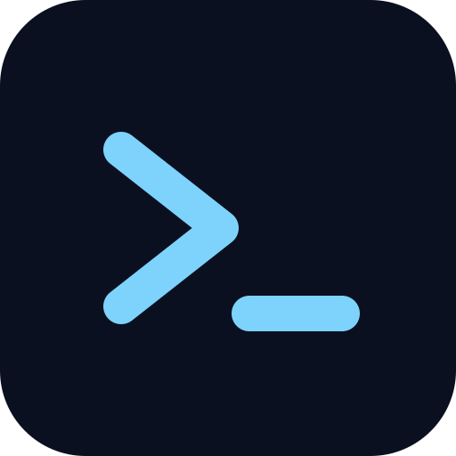
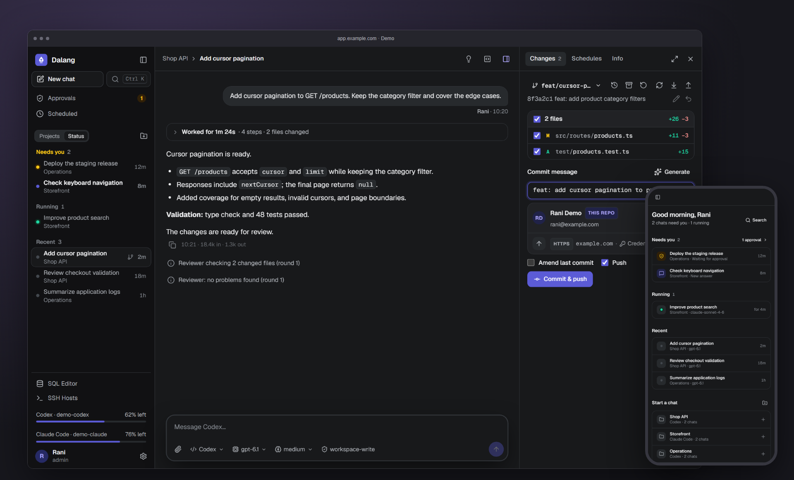
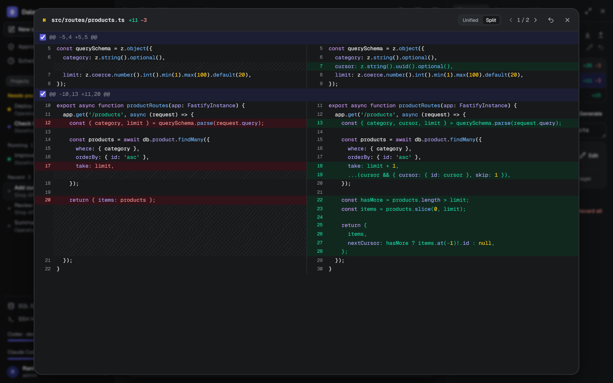
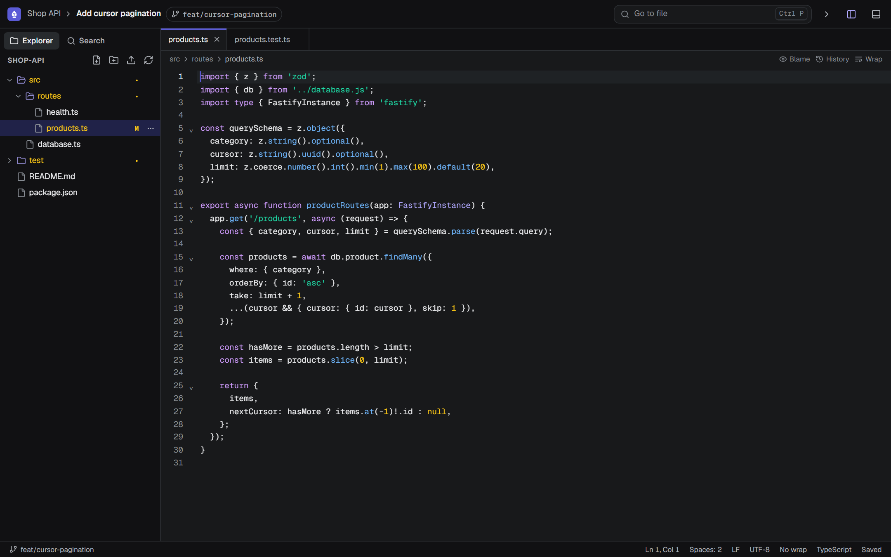
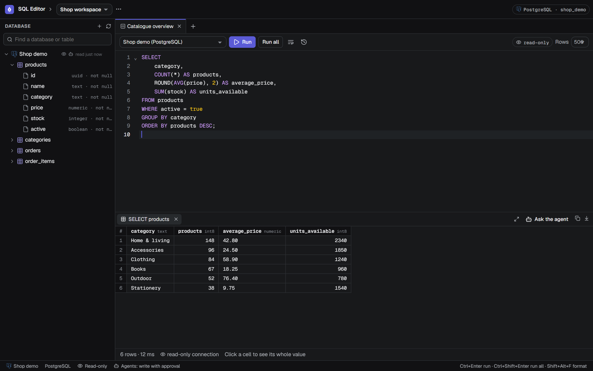
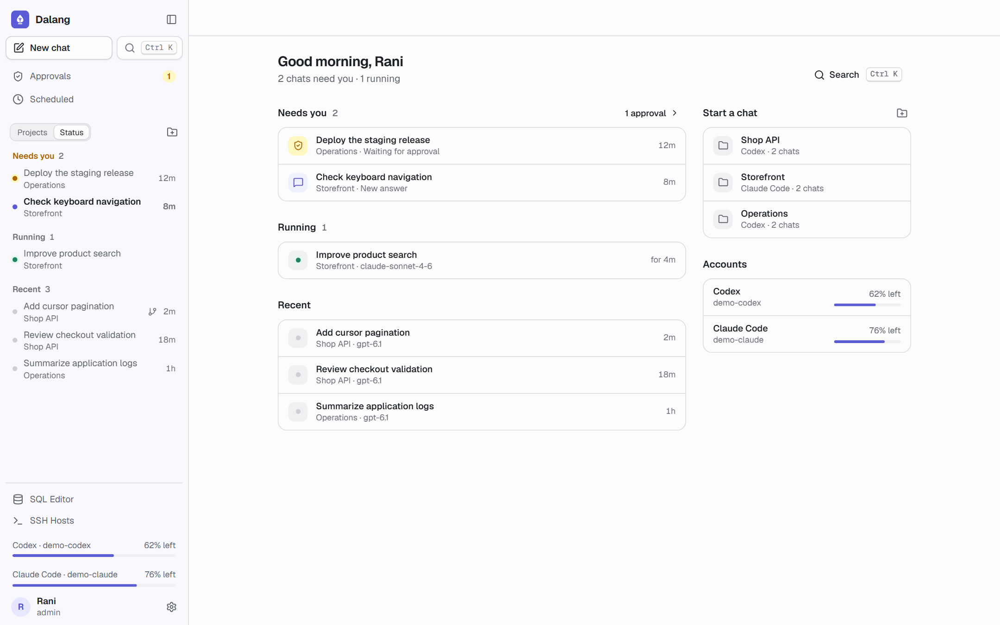
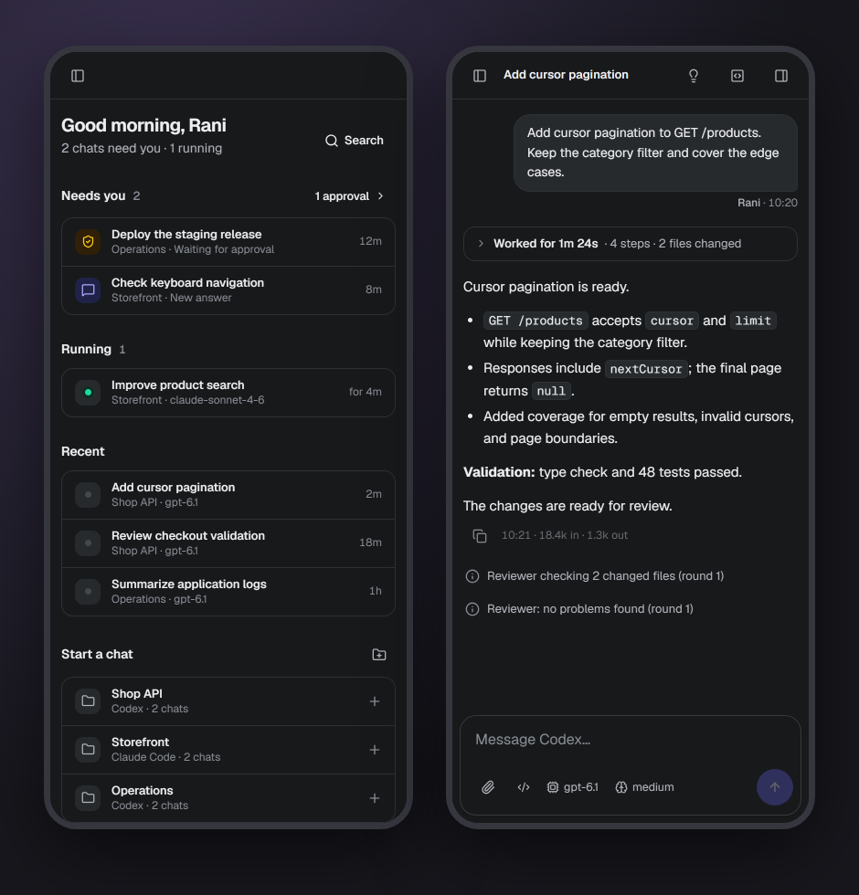

<div align="center">



# Dalang

**The puppeteer behind the screen.**<br>
A self-hosted control room for **Codex CLI** and **Claude Code** agents: a web panel you can install on your phone,<br>
and an HTTP/MCP API, running agent sessions on your own machine.

[](https://github.com/luzyver/lzvr-dalang/actions/workflows/ci.yml)


[](LICENSE)

[Quick start](#quick-start) · [Setup](docs/setup.md) · [Design](docs/design.md) · [Install](docs/setup.md#install-on-the-vm-no-docker) · [MCP API](docs/integrations.md#mcp) · [Contributing](CONTRIBUTING.md)

<br>



</div>

<br>

lzvr-dalang (the panel calls itself Dalang) runs headless `codex exec` and `claude` sessions on your own VM, streams
what they do into the panel, and fails over between your own accounts when one hits its usage limit. Part of the
`lzvr` toolbox (environment variables are `LZVR_*`).

## Highlights

<table>
<tr>
<td width="33%" valign="top">

**Parallel chats per project**<br>
Each chat has its own agent session, draft and prompt queue, optionally in its own git worktree.

</td>
<td width="33%" valign="top">

**Live view and inbox**<br>
Stream commands, edits and answers; find chats waiting for approval, failed runs and unread answers across projects.

</td>
<td width="33%" valign="top">

**Git without leaving the chat**<br>
Diffs, hunks, commit and push, stashes, conflicts, history, checkpoints and Merge Requests.

</td>
</tr>
<tr>
<td valign="top">

**Account failover**<br>
A usage limit resumes the turn on your next account of the same backend. Signed-out accounts are skipped and can be signed in again.

</td>
<td valign="top">

**MCP gateway**<br>
Other agents drive chats through `/mcp`; a chat's agent can start sub-agents and hear back.

</td>
<td valign="top">

**Code editor and terminals**<br>
CodeMirror editor, file tree, search and terminals in the folder each chat works in.

</td>
</tr>
<tr>
<td valign="top">

**Databases and SSH**<br>
Query six database engines, export results and run SSH commands, with configurable agent access and approval policies.

</td>
<td valign="top">

**Scheduled prompts**<br>
Cron schedules that keep a conversation going, with a push notification when each run ends.

</td>
<td valign="top">

**Access controls**<br>
Email codes, users and roles, read-only projects, approvals, and stored connection secrets encrypted at rest.

</td>
</tr>
<tr>
<td valign="top">

**Memory across chats**<br>
Project decisions and personal preferences carry into later turns. Optional code graphs map symbols, calls and routes.

</td>
<td valign="top">

**Automatic review**<br>
An optional read-only reviewer checks changed files and sends findings back for bounded correction rounds.

</td>
<td valign="top">

**Skills and design checks**<br>
A shared engineering skill library and an Impeccable hook that checks UI edits and feeds findings to the agent.

</td>
</tr>
</table>

## Working with a chat

1. Add a project folder or clone a repository, then choose Codex or Claude Code. Start a chat in the project folder
   or in an isolated git worktree; attach files and images when the task needs them.
2. Send prompts while watching the live transcript. Each chat keeps its own queue, model, effort and session.
   The sidebar groups chats by project or status, and Home shows what needs attention. Unread markers are stored
   on the current browser, not synchronized between devices.
3. Review the result in the Changes inspector: inspect diffs, select hunks, restore checkpoints, commit, push or
   open a pull request. By default agents leave changes uncommitted; these actions belong to the panel user.
4. Keep work going with scheduled prompts, optional sub-agents and project memory. Enable the automatic reviewer
   to check changes after a request; its findings return to the original chat for correction.

Long sessions use the CLI's native context compaction, with active context and cumulative chat usage shown
separately. Managed restarts give active turns time to finish (`DRAIN_MINUTES`, default 5); unfinished turns are
queued to resume after startup. See the [design and execution flow](docs/design.md).

## Architecture



The gateway combines access controls, SQLite-backed queues, scheduled prompts and account failover. CLI sessions
work in project folders or isolated worktrees; live events feed the panel, and interrupted work can resume after restart.

Memory, code graphs and shared skills prepare each turn. Sub-agent reports and optional review findings return to
the parent chat. Built-in database and SSH tools enforce configured access and approval policies.

Open the [scrollable overview](docs/diagrams/overview.html), or see the three detailed diagrams in the
[design and execution flow](docs/design.md).

## Screenshots

<table>
<tr>
<td width="50%"><p align="center"><sub><b>Review every hunk</b> before it is committed</sub></p></td>
<td width="50%"><p align="center"><sub><b>Code editor</b> on the chat's own folder</sub></p></td>
</tr>
<tr>
<td width="50%"><p align="center"><sub><b>SQL editor</b> with a result grid and agent access per connection</sub></p></td>
<td width="50%"><p align="center"><sub><b>Inbox in light mode</b>: approvals, unread answers and running agents</sub></p></td>
</tr>
<tr>
<td colspan="2" align="center"><p align="center"><sub><b>Installable on your phone</b>, with Web Push when a turn finishes or needs you</sub></p></td>
</tr>
</table>

<sub>Screenshots are captured from the current panel with fictional projects, conversations and query results.
See <a href="CONTRIBUTING.md#readme-screenshots">how to refresh them</a>.</sub>

## Quick start

Try it locally (Node 22.13 or newer, and the `codex` or `claude` CLI on PATH):

```bash
git clone https://github.com/luzyver/lzvr-dalang.git && cd lzvr-dalang
npm ci
cp .env.example .env    # set LZVR_TOKEN (openssl rand -hex 32), WORKSPACE_ROOT, and AUTH_BYPASS=true for local use
npm run dev             # http://127.0.0.1:9876
```

Open the panel, add a Codex or Claude Code account in Settings, add a project folder and start a chat. On Windows,
`run.cmd` does all of this in one go (see [Development workflow](CONTRIBUTING.md#development-workflow)). For a real server, follow
[Install on the VM](docs/setup.md#install-on-the-vm-no-docker): systemd, nginx with HTTPS, and email sign-in.

Set `MCP_INJECT=1` in `.env` to give chat agents the gateway's tools for sub-agents, memory, databases and SSH.
Configure connections and access policies in the panel; the optional code graph also needs a configured
`codebase-memory-mcp` binary. Neither is required to start a basic chat.

Agents execute on the host with the selected backend's permissions. Gateway approvals and git hooks are not an
OS isolation boundary; review the [security model](docs/setup.md#security) before exposing a server.

## Documentation

| Document | Contents |
| --- | --- |
| [Setup](docs/setup.md) | Installation, updates, accounts, git credentials, configuration and security |
| [Integrations](docs/integrations.md) | HTTP API, MCP, sub-agents, ClickUp, databases, SSH and approval policies |
| [Design](docs/design.md) | Architecture diagrams, turn lifecycle, memory, review, panel workflows and trust boundaries |
| [Contributing](CONTRIBUTING.md) | Local development, Windows scripts, vendored libraries, checks and contribution conventions |

## Contributing

See [CONTRIBUTING.md](CONTRIBUTING.md) for setup, checks and commit style, [SECURITY.md](SECURITY.md) to report a
vulnerability, and [CHANGELOG.md](CHANGELOG.md) for notable changes.

## License

[MIT](LICENSE) © luzyver. Bundled third-party code keeps its own license: the browser libraries and fonts in
`public/vendor` and `public/fonts` (see [public/vendor/README.md](public/vendor/README.md)), the Lucide icons in
`public/icons` ([public/icons/LICENSE](public/icons/LICENSE)), and the diagram-design skill
([skills/diagram-design/LICENSE](skills/diagram-design/LICENSE)).
