# Architecture and execution flow

This describes the current implementation. For installation and accounts, see [Setup](setup.md); for MCP, databases and SSH, see [Integrations](integrations.md).

Start with the [single system overview in the README](../README.md#architecture), or open its
[scrollable version](diagrams/overview.html). The three diagrams below expand that overview.

The diagrams use the portfolio's graphite palette, orange focal nodes and orthogonal connections, with content
mapped to the current implementation. Three views separate execution, context and scoped tools so their
relationships remain readable. Solid arrows show the main connections; dashed arrows show conditional paths.

- [Execution](#a-chat-turn), [review](#review-and-design-checks), [persistence](#persistence-and-restart)
- [Active context](#active-chat-context), [project memory](#project-memory), [code memory](#code-memory)
- [Agent git policy](#agents-and-git), [panel workflows](#panel-workflows), [trust boundaries](#trust-boundaries)

## Gateway and execution

The dispatcher persists queues, emits live events and resumes interrupted work after a managed restart.
Account failover retries the same turn within its backend. Inbox, editors and Changes are panel features;
they are not separate services. [Open the scrollable overview](diagrams/architecture.html).

## Context and review

Project and personal memory are injected into turns. Optional code memory refreshes a stale graph before execution;
shared skills and policies provide instructions. The automatic reviewer uses checkpoint diffs and returns findings
for bounded corrections. Design hooks supply separate advisory feedback. Successful turns can also trigger optional
memory extraction; that write-back is omitted from the drawing. [Open the context diagram](diagrams/context-review.html).

## Tools and sub-agents

Sub-agents have their own sessions and can use worktrees. Their reports enter the parent's prompt queue.
Built-in tools enforce conversation, user and project scope; database and SSH operations may wait for approval.
Native CLI filesystem access and configured external MCP servers remain separate permission boundaries.
[Open the tools diagram](diagrams/tools-agents.html).

| View | Implementation anchors |
| --- | --- |
| Gateway and execution | [Startup](../src/main.ts), [dispatcher](../src/dispatcher.ts), [schedules](../src/schedules.ts), [state](../src/store.ts) |
| Context and review | [Memory](../src/memory.ts), [code memory](../src/code-memory.ts), [reviewer](../src/reviewer.ts), [design hooks](../src/design-hook.ts) |
| Tools and sub-agents | [Built-in MCP and connection policies](../src/mcp.ts), [external MCP configuration](../src/mcp-servers.ts), [child reporting](../src/dispatcher.ts) |

## Components

One Node.js process hosts the Fastify gateway, serves the panel and dispatches headless CLI processes. The panel
uses Preact, htm and signals as browser modules; no frontend build is needed to run it. Browser dependencies and
fonts are committed in `public/vendor/` and `public/fonts/`, regenerated with `npm run vendor` when updated.

| Boundary | Implementation | Responsibility |
| --- | --- | --- |
| Startup | `src/main.ts`, `src/config.ts` | Load configuration, open state, restore queues, start HTTP, indexing and scheduling |
| HTTP and access | `src/app.ts`, `src/auth.ts`, `src/otp.ts`, `src/panel.ts` | Authentication, project access, API routes, static panel and SSE |
| Turn execution | `src/dispatcher.ts`, `src/runner.ts`, `src/codex.ts`, `src/claude.ts` | Queue dispatch, CLI selection, session resumption, events and cancellation |
| Accounts | `src/accounts.ts`, `src/login.ts`, `src/sessions.ts` | Sign-in, account eligibility, usage-limit failover and session sharing |
| State and context | `src/store.ts`, `src/memory.ts`, `src/chat-context.ts`, `src/context.ts`, `src/token-usage.ts` | SQLite state, durable facts, history handoff and context/usage reporting |
| Agent integrations | `src/mcp.ts`, `src/mcp-servers.ts`, `src/code-memory.ts`, `src/code-memory-routes.ts` | Scoped MCP tools, external MCP configuration and code graph access |
| Review and skills | `src/reviewer.ts`, `src/design-hook.ts`, `src/skills.ts`, `skills/` | Read-only review, UI edit checks and shared skill instructions |
| Git and files | `src/git*.ts`, `src/forge.ts`, `src/code-routes.ts`, `src/code-search.ts`, `src/terminals.ts` | Worktrees, checkpoints, diffs, forge actions, editor and terminal sockets |
| Connections | `src/databases.ts`, `src/database-routes.ts`, `src/nosql.ts`, `src/db-export.ts`, `src/ssh*.ts`, `src/secrets.ts` | Database/SSH access, approval workflows, tunnels and encrypted credentials |
| Background work | `src/schedules.ts`, `src/cron.ts`, `src/push.ts` | Scheduled prompts and completion/approval notifications |
| Browser | `public/app.js`, `public/js/`, `public/css/` | Chat, inbox, Changes inspector, editors and settings, with styles split by responsibility |

The graph service, connected databases, SSH hosts and external MCP servers are optional integrations. They are
not required for a basic chat. The database editor's connections are separate from the gateway's own SQLite store.

## A chat turn

1. An authenticated HTTP or MCP request, a schedule, or an approved action adds a prompt to the conversation's
   persisted queue. The dispatcher runs queued work sequentially within that conversation; other chats can run
   concurrently. Worktrees give parallel editing chats separate working directories.
2. The dispatcher selects the chat's backend, model, effort and working directory. For writable git projects it
   saves a checkpoint before execution. If an existing code graph is stale, it attempts a refresh before starting
   the agent; a refresh failure is reported and execution can continue with the old graph.
3. The turn receives applicable memory, skill instructions, git policy and context-retention guidance. With
   `MCP_INJECT=1`, it also receives a short-lived token tied to the conversation and requesting user. External MCP
   servers are configured separately according to their sharing policy.
4. A CLI subprocess starts or resumes its native session. Both backends emit events through the dispatcher, which
   stores them and broadcasts them to the panel over SSE. Reopening a chat can replay its stored history.
5. A usage-limit failure temporarily blocks that account and retries the same turn with another eligible account
   of the same backend. The continuation prompt tells the agent to inspect completed work rather than repeat it.
   Signed-out and disabled accounts are skipped. With no eligible account, the turn fails with an explanation.
6. The dispatcher revokes the turn token, saves the final status and an after-checkpoint where applicable, and
   notifies subscribers. Successful top-level turns can trigger memory extraction and optional automatic review;
   sub-agents return their final report to their parent as queued work.

Native context compaction belongs to the CLI. The gateway requests a context window and retains the full event
history so the agent can retrieve omitted detail. Active-context samples and cumulative token totals represent
different measurements; see [Active chat context](#active-chat-context).

## Review and design checks

**Settings → Model & effort** includes two separate controls:

- **Automatic reviewer** (off by default): after a completed top-level chat turn changes files in a writable git
  project, a read-only reviewer compares the changes with the person's request using the before/after checkpoints.
  It waits for queued work and sub-agents to finish. Findings are queued back into the original chat for correction;
  the default limit is two review rounds per request. Admins can choose a backend, model, effort, round limit and
  review instructions. Reviewer turns consume account usage and do not commit or merge the changes.
- **Design detector** (on by default): the bundled Impeccable hook checks UI files after edits and makes a deeper
  pass when the turn ends. Findings go into the agent's context; the hook does not block edits. It skips read-only
  turns and avoids installing a duplicate project hook. Codex hook injection also depends on CLI support and the
  project's existing hook configuration. Its `.impeccable/hook.cache.json` is excluded locally from git changes.

The engineering skills in `skills/` are listed in chat instructions for both backends. Agents read relevant
`SKILL.md` files and their supporting references as needed; the library is part of the application, not temporary
output. The detector and reviewer are independent of whether an agent uses a skill.

Administrative approvals are separate from the reviewer and design detector: see
[database policies](integrations.md#sql-editor), [SSH policies](integrations.md#ssh-hosts-for-agents) and
[MCP delegation](integrations.md#mcp). Review state persists across restarts; late findings are marked when they
belong to an earlier request.

## Persistence and restart

| Location | Contents and lifetime |
| --- | --- |
| `<STATE_DIR>/lzvr.db` | Projects, conversations, queues, turns, events, schedules, approvals, settings and memories |
| Account directories under `STATE_DIR` | CLI authentication/configuration and session data used for resumption |
| `<STATE_DIR>/worktrees/<chat id>` | Optional per-chat git working copy; deleting a worktree chat can remove uncommitted work |
| `<STATE_DIR>/uploads` | Attachments managed by the gateway |
| Project repositories | Files, branches and checkpoints under `refs/dalang/checkpoints/<chat>/` |
| Browser storage | Device-local preferences such as theme, pane layout and unread markers |

Project memories survive deletion of their source chat. Personal memories belong to the user and follow that
user across projects. Code graphs are maintained by the optional code-memory integration and describe the project
folder; a worktree's unmerged changes may differ from that graph.

On a managed restart, the scheduler stops and the dispatcher stops starting new turns while active ones get up to
`DRAIN_MINUTES` to finish. The panel stays available during this drain. Remaining active turns are interrupted and
queued to continue in their sessions after startup. Linux uses SIGTERM with a `KillMode=mixed` systemd drop-in;
Windows `autostart.cmd restart` uses the restart flag handled by `src/main.ts`. SIGINT stops without a drain period.
After an unexpected crash, leftover running records are reset and remaining queues are restarted.

The PWA service worker handles installation and push notifications; it does not cache an offline copy of the app.

## Trust boundaries

- The gateway checks authentication, roles and project access. A turn-scoped MCP token opens only `/mcp` and is
  revoked when the turn ends; it does not grant the full HTTP API access of the owner token.
- Database and SSH policies are enforced by their gateway tools. Operations requiring approval are held for an
  admin. External MCP servers have their own permissions and credentials.
- Agents are host processes. Their effective filesystem and command permissions depend on the backend and
  configured sandbox. Gateway access controls do not isolate a hostile process from readable host files.
- The subprocess runner removes inherited `LZVR_*` variables and injects the credentials required for that turn.
  Stored connection secrets are encrypted with AES-256-GCM; protection still depends on where the key is kept and
  what the agent's OS account can read.
- Agents are instructed and configured not to commit or push by default. The panel performs user-initiated Git
  operations separately. Git hooks discourage accidental commits but are not a security sandbox.

See [Security](setup.md#security) for deployment implications and [Agents and git](#agents-and-git) for
the exact policy and its limits.

## Active chat context

Chat turns request earlier **native compaction** in both agents, including resumed sessions. Codex receives
[`model_auto_compact_token_limit`](https://developers.openai.com/codex/config-reference); Claude Code receives
[`CLAUDE_CODE_AUTO_COMPACT_WINDOW`](https://code.claude.com/docs/en/env-vars). The default is 100,000 tokens.
The CLI applies its own model limits, headroom and compaction settings; the effective trigger can be earlier.
Compaction must be enabled in the CLI. `CONTEXT_COMPACT_TOKENS=0` removes Dalang's override and retention guidance.
Title generation, memory extraction and commit-message requests keep their existing settings.

The CLI watches **active context**, not accumulated input tokens across a session or all calls within a turn.
It creates a continuation summary when needed and keeps the same session. Dalang adds guidance to preserve the
original goal, user constraints/corrections, decisions, modified files, checks and unfinished work. Older detail
may be omitted from the model's summary; the full transcript remains in Dalang and agents with MCP can retrieve
missing messages using `get_events` with `messages_only:true`, or tool output using full events.

The chat footer shows **Context** separately from **Chat total** when a real sample is available. Codex samples come
from `last_token_usage` in the session rollout; Claude samples come from the latest assistant message's usage,
including cached input and output. These are last-reported samples, not estimates from cumulative usage. A native
compaction boundary invalidates older samples until a fresh request reports one, and the chat records a
**Context compacted** note. No extra summary request is made on every turn, and no SQLite migration is required.

## Project memory

Every project keeps a memory: short facts from its chats that later chats should know, such as decisions and
preferences the person stated, corrections, conventions, how to build, run, test or deploy, and where hard-to-find
things are. It belongs to the project, not to a chat: deleting a chat leaves its memories behind (each still names the
chat it came from), and they go only with the project.

Each person also has a memory of their own: preferences they gave about how agents should work with them ("answer in
Indonesian", "never add a Co-Authored-By line"), shown to every turn they send in any project. Only they see and change
it (the owner does not see other people's), and it goes when the user is deleted.

- **Kept on their own.** After each finished turn of a person's chat, one small read-only request (the same CLI, with
  no tools and no session kept) reads what was asked and the agent's final answer, next to what the project already
  keeps, and answers which facts to add, which to rewrite and which are now wrong. It is told to skip what the code or
  git history shows, the steps of the chat, guesses and secrets, so most turns add nothing. These requests run one at a
  time per project and count against the account's usage. Sub-agents' turns are skipped: their report comes back to
  the parent, whose turn reading it counts. A failed request is only logged. When a person typed the prompt, the same
  request may also keep a preference for that person's own memory, but only one they stated themselves as a wish for
  later work ("always...", "never...", "next time..."), never one guessed from how they write; a prompt an agent or an
  approval queued keeps nothing for a person.
- **Shown to every turn.** About 6000 characters of memories, each with its `[id]`, go into every turn's instructions
  (the person's own first, up to about 1500 characters, then the project's in the room left; a turn queued for a person
  by an agent or an approval gets theirs too)
  through `--append-system-prompt` / `developer_instructions`, on Codex and Claude Code alike, with a note that what the
  person says now and what the code shows win over them. Which ones, in each: first any the prompt names by `[id]`, then those that best
  match the prompt's words (a full-text index, SQLite FTS5 with BM25; a word also matches as the start of a longer one,
  so "deploy" finds "deployment"; common English and Indonesian words are ignored), up to two thirds of the room, then
  the newest. So a memory the request is about is shown however old it is, and what changed last is shown too. It
  matches words, not meaning: "rilis" does not find "release". The extraction request is given memories picked the same
  way (about 16000 characters), so it sees near-duplicates. Where Node's SQLite lacks FTS5, matching counts the prompt's
  words in each memory instead (a warning is logged at startup).
- **Agents.** With `MCP_INJECT=1`, chats get `memory_search`, `memory_save`, `memory_update` and `memory_forget`: on their
  own project, or any other project their user may open (`project_id`), or with `scope: "mine"` the own memory of the
  person the turn runs for (none for a turn no person sent). They are told to save on purpose only what a later chat
  must not miss.
- **People.** The lightbulb button in a chat's header opens the memory, with a tab for the chat's project and one for
  your own: search, add, edit or forget. Everyone who may open the project may change its memory (the same as with its
  chats); your own is yours alone (`/api/me/memories`).
- **Settings → Project memory** (admins): keeping facts from turns on or off (on by default), the model per backend
  (default: the chat's own; a small one is enough), the reasoning effort (default `low`), and whether people's stated
  preferences are kept for them too (on by default). `AUTO_MEMORY=0` on the
  server turns the automatic part off whatever is set there; memories saved on purpose still work and are still shown.

## Agents and git

By default a chat's agent does not commit or push: you do that from the chat's **Changes** tab (commit, push, Merge
Request), which Dalang runs with its own git, outside any turn. **Settings → Model & effort → Commits and pushes**
(admins) has a switch for each.

- **Told**: every turn is told not to commit or push, even when asked, and to leave its changes ready for you.
- **Blocked** in the agent's own git, for Codex and Claude Code alike, through git config in the turn's environment
  (`GIT_CONFIG_COUNT`, read by every git it runs): `core.hooksPath` points at `scripts/agent-git-hooks`, whose
  `pre-commit` and `pre-merge-commit` refuse, and every push URL is rewritten (`pushInsteadOf`) to a path that cannot
  exist. Fetching, branches, stashes and the rest work as before.
- **Limits**: `--no-verify` skips the commit hooks, and the hooks path leaves the repository's own git hooks out of the
  agent's git. This stops habit, not an agent set on getting round it; a push needs more (an explicit `pushurl`).

## Code memory

**Settings → MCP → Code memory** (the owner only) turns on a graph of each project's code (symbols, calls, imports,
HTTP routes) from [codebase-memory-mcp](https://github.com/DeusData/codebase-memory-mcp) (CBM), so agents answer
"who calls this", "what does this change touch" or "how does this fit together" from the graph instead of grepping
file by file. Give the path of the CBM binary (a release from its GitHub page; nothing to configure in the agents),
**Test binary**, turn it on.

- **Dalang runs it**: one CBM session for the whole server, started with Dalang's state dir as its folder. A project's
  first index is made only when someone asks: the owner with **Index** / **Reindex** in the tab, an admin with the brain button in a chat's
  header (shown only while code memory is on and the project's code changed since its graph, or it has none yet), and anyone else with that button too, as a request an admin or the owner approves in **Approvals** (it runs
  then; a push notification says one waits). Everyone only for projects they may open. A first index uses several cores for seconds to minutes;
  indexing again only reads what changed and takes seconds. The tab lists each project's index, and marks it
  **files changed since** when the project's git state (HEAD or uncommitted changes) differs from the one it indexed.
- **A turn reads the graph of the code as it is now**: when a prompt arrives for a project whose graph exists but whose
  files changed since, Dalang reindexes it first and the agent starts only once that is done (the chat shows a note;
  a cancel stops the wait). A reindex that fails is noted too, and the turn goes on with the previous graph. Nothing
  else reindexes on its own (not pulls, edits or time passing). A chat with its own worktree reads the graph of the
  project's main folder, so only changes there count.
- **Deleting a project** deletes its graph from CBM too (unless another project on the same folder shares it), also
  when the project goes while its index still runs. One CBM cannot delete right then (code memory off) is deleted
  when the next CBM session starts.
- **Chats query it through `/mcp`**, as `code_search_graph`, `code_trace_path`, `code_get_code_snippet`,
  `code_get_architecture`, `code_query_graph` and the other read tools, on their own chat's project (or another project
  their user may open, by `project_id`). CBM itself would show every indexed repository to anyone; through the gateway
  a chat never reaches a project its user may not open. Indexing, deleting and listing other repositories stay with
  Dalang. Every user's chats get it, so it needs `MCP_INJECT=1` like the rest of `/mcp`.
- **Turns are told** (next to the sub-agent and database guides) that the project has a graph and to use it before
  grepping. A chat in its own worktree uses the project folder's graph, and is told to read files it changed itself.
- **Hooks** (on by default, a checkbox in the tab): turns also run `scripts/code-memory-hook.mjs` next to their own
  searches. It hands the hook event to CBM's `hook-augment` with the project folder as its folder, so the agent sees
  the graph symbols matching its search next to the tool's own result, from its own project's graph only, worktree
  chats included. The hook never blocks a tool: an error or a 4-second timeout just adds nothing.
  - **Claude Code** gets `--settings` hooks before each Grep, Glob or Bash search, and after each Read (what the graph
    could not parse in that file).
  - **Codex** gets an inline `-c hooks.PreToolUse` hook before its shell commands (`rg`, `grep`, ...). Codex runs only
    hooks a person trusted in `/hooks`, so the turn gets `--dangerously-bypass-hook-trust`, which runs *every* enabled
    hook unreviewed for that turn: the account's own (`CODEX_HOME`, yours) and a repository's `.codex/` hooks if Codex
    loads them. A turn whose folder or project folder has `.codex/hooks.json` or hooks in `.codex/config.toml` therefore
    gets no hook from Dalang (and no bypass). Codex 0.162.1 was checked. Dalang reads `codex exec --help` once
    (restart it after updating Codex): a Codex that does not know the flag gets no hook rather than a failed turn.

## Panel workflows

The [README](../README.md#working-with-a-chat) covers the everyday chat flow. These details matter when editing
or restoring project files:

- **Worktrees:** a new worktree chat starts at the project's HEAD on its own branch under
  `<STATE_DIR>/worktrees/<chat id>`. Deleting it removes that working copy, including uncommitted files. Branches
  with unmerged commits are retained; a merged remote branch is removed only when it has not advanced.
- **Changes inspector:** commit selected files or hunks, inspect diffs and history, switch branches in a plain chat,
  and create Merge Requests. A worktree chat stays on its own branch. Operations that change files are refused
  while an agent is running in the same folder; in read-only projects they are admin-only.
- **Publishing:** the commit form's Push option controls whether a commit is pushed immediately. A failed push
  leaves the local commit intact. Merge Requests use `gh` or `glab`; a worktree targets its starting branch, while
  a plain chat targets the remote default branch. See [forge setup](setup.md#merge-requests-gh-and-glab).
- **Credentials:** Changes shows the author and remote credentials. Repository-local author settings are shared
  across worktrees; other panel users have their own [git setup](setup.md#each-users-own-git-setup). Missing
  credentials fail without opening a login prompt.
- **Sync and conflicts:** Pull fast-forwards; diverged branches offer merge or rebase. Resolve each conflict in the
  editor or ask the agent, then Continue or Abort. Rewriting a pushed feature branch requires confirmation and a
  force push with a lease; the default branch is protected from those rewrite actions.
- **Recovery:** stashes include untracked files and are shared by the repository's worktrees. Turn checkpoints
  preserve before/after file states without moving the branch or index. Restoring a checkpoint also replaces later
  working-copy changes; Undo the last restore reverses that restore. Checkpoints are removed with their chat.
- **History and review:** compare refs, cherry-pick, revert and tag commits. An opened Merge Request shows CI and
  review comments; Address comments and Fix checks queue work for the chat's agent. Merging remains a user action.
- **Generated text:** commit subjects and Merge Request descriptions use read-only, sessionless requests on the
  chat's backend/model and consume account usage. Admins can edit the generation instructions.
- **Editor:** the code button opens the chat's project folder or worktree. Search, replace, blame, file history,
  uploads and terminals are available. External edits reload automatically unless there are unsaved changes;
  saving never silently overwrites a newer file. Read-only and running-agent restrictions also apply here.
  Binary files and files over 5 MB are download-only; `.git` is excluded from editor operations.
- **Shortcuts:** `Ctrl P` opens files, `Ctrl Shift P` lists editor commands, `Ctrl Shift F` searches files,
  `Ctrl K S` saves all, and `Ctrl B` toggles the file tree. Browser-reserved shortcuts use alternatives:
  `Alt W` closes a tab, `Alt N` creates a file and `Alt Shift T` reopens a tab. `Ctrl K` / `Cmd K` in the panel
  searches chat titles, prompts and answers (not tool output) and offers common actions.
- **Terminals:** sessions survive closing the editor and replay their recent output on reconnect. They close after
  an hour without a viewer or when their chat is deleted. Non-owner access on Linux requires the
  [terminal account setup](setup.md#terminals-without-root).
- **Scheduled prompts:** Inspector → Schedules uses cron in the server's time zone, including shortcuts such as
  `@daily`. Run now queues an immediate turn. Duplicate pending prompts are skipped; overdue schedules run once
  after downtime instead of replaying every missed interval. Anyone allowed to send prompts can schedule them.

## Repository maintenance

`src/`, `public/`, `test/`, `scripts/` and `skills/` are application inputs. Vendored browser chunks, fonts, icon
licenses, screenshots and skill examples are intentional repository assets. Check imports, dynamic loading,
documentation links and tests before removing them.

`dist/` is generated by `npm run build` and ignored by Git. TypeScript does not remove outputs for deleted source
files, so obsolete outputs can remain after a source module is removed. Remove only verified orphan outputs;
`npm start` uses the rest of this directory. `state/` and `.env` contain runtime data and configuration, not cleanup
candidates.
